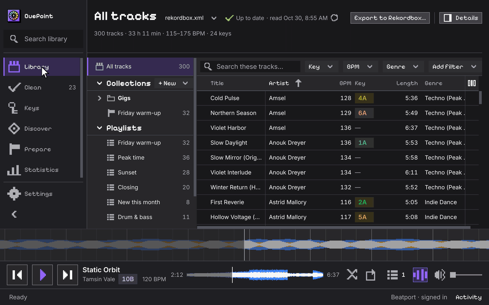
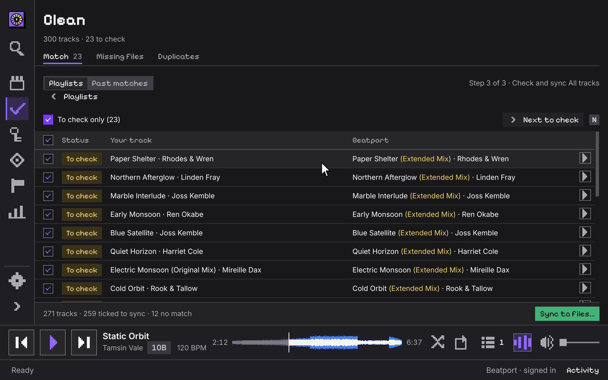
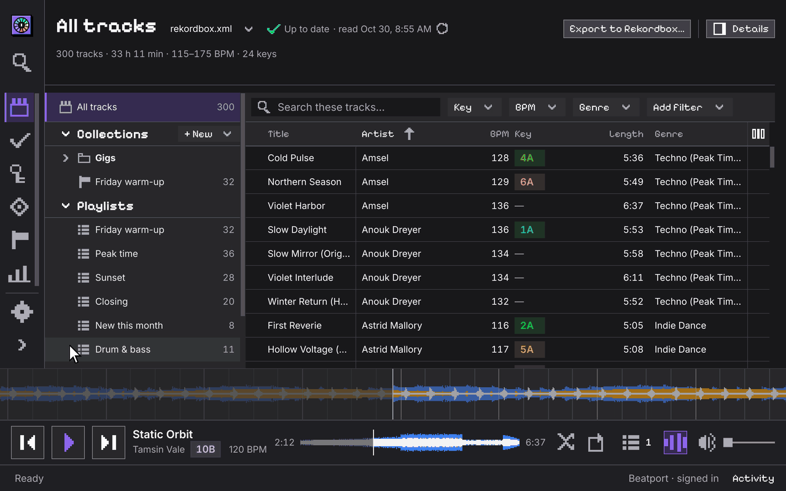
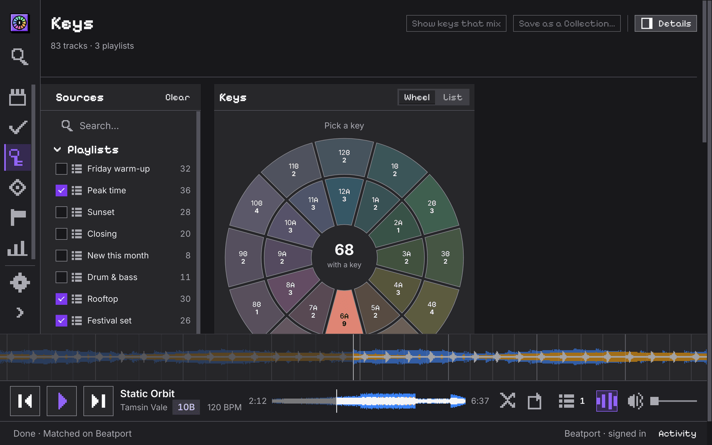
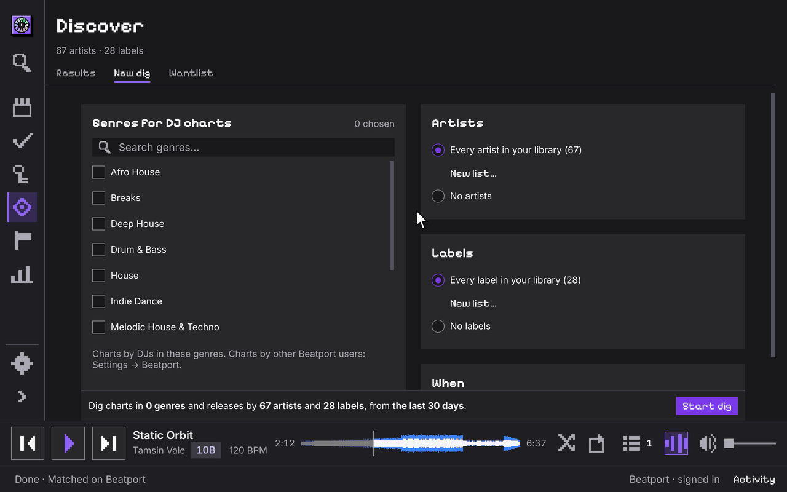
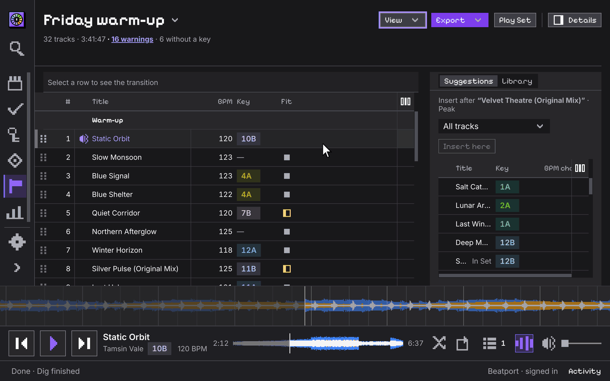
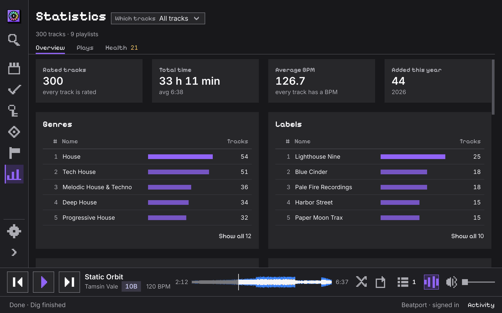
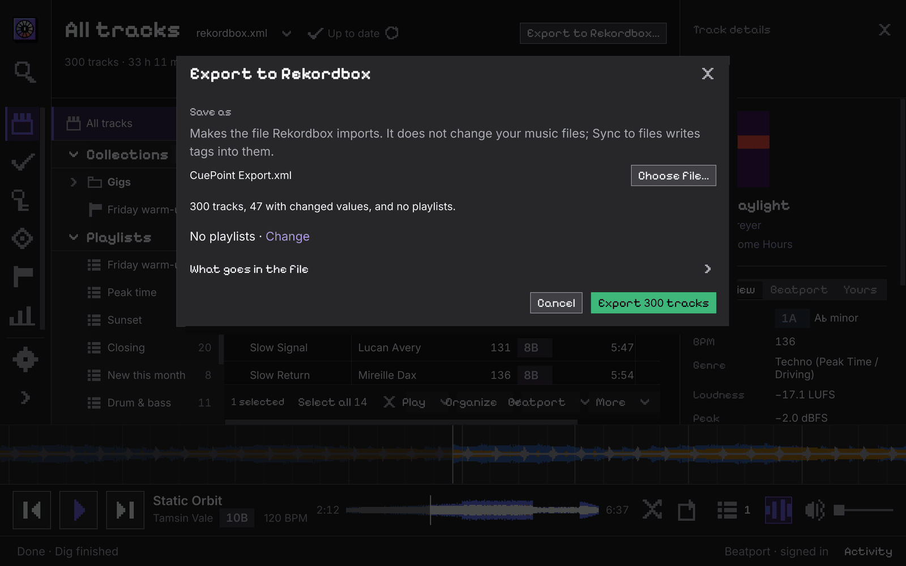

<div align="center">

<a href="https://usecuepoint.com"></a>

# CuePoint

### Clean up your Rekordbox library with Beatport.

**A free desktop app for DJs.** CuePoint matches your Rekordbox tracks to Beatport, fills in the
keys, tempos, genres and labels that are missing or wrong, and sends the cleaned library back to Rekordbox.

[](https://usecuepoint.com/download/)
[](https://usecuepoint.com)

[](https://github.com/stuchain/CuePoint/releases)
[](LICENSE)
[](https://usecuepoint.com/download/)
[](https://github.com/stuchain/CuePoint/stargazers)

[Website](https://usecuepoint.com) · [Download](https://usecuepoint.com/download/) · [Features](https://usecuepoint.com/features/) · [Guide](https://usecuepoint.com/guide/) · [FAQ](https://usecuepoint.com/faq/) · [Report a bug](https://github.com/stuchain/CuePoint/issues/new/choose)

<br>



</div>

<br>

## Why CuePoint

Years of tracks, and the keys, tempos and genres do not agree. Half the collection has no key, or a key
you do not trust. The genre is blank on some tracks and wrong on others. Fixing that by hand, one track at
a time, takes a weekend, so most DJs never do it and then dig through the wrong tracks at the gig.

CuePoint does the dull part for you:

1. **Import** the collection you export from Rekordbox as XML.
2. **Match** a playlist or the whole library on Beatport. Sure matches are accepted; the rest wait for a quick yes or no.
3. **Export** a new Rekordbox XML file with the corrected keys, tempos and genres, and import it into Rekordbox.

Your own corrections always stay on top, and every change can be undone.

<table>
<tr>
<td width="20%" align="center"><b>Free</b><br><sub>Free to download and to use</sub></td>
<td width="20%" align="center"><b>Runs on your computer</b><br><sub>Your library never leaves it</sub></td>
<td width="20%" align="center"><b>Nothing deleted</b><br><sub>Your music files are never moved or removed</sub></td>
<td width="20%" align="center"><b>Made for Rekordbox</b><br><sub>Reads and writes Rekordbox XML</sub></td>
<td width="20%" align="center"><b>Open source</b><br><sub>Apache 2.0, on GitHub</sub></td>
</tr>
</table>

## Features

### Clean: fix missing and wrong keys with Beatport

Match a playlist, a Collection or the whole library to Beatport. CuePoint keeps every candidate it found,
with a score and the reason it turned down the others. It accepts a match on its own only when the best
candidate scores 95 or more and passes every check; everything else waits for you, one track beside its best
Beatport result, in **Check the match**: one key or click uses a match and moves on.

- Beatport's **key** on every matched track, with **BPM, genre, label and release year** offered beside it
- **Duplicates**: tracks that may be the same recording, grouped for you
- **Missing files**: what moved or went unreadable, so you know what to relocate in Rekordbox
- A **Health** tab that counts everything that needs you
- **Sync to files** writes the corrected tags into your music files too, after a preview



### Library: your whole collection, searchable and filterable

Search every track, filter by key, BPM or genre, and see the cover, waveform, cue points and history of any
track in Track details. Keep your own **Collections** and **Smart Collections** beside Rekordbox's playlists.
The **Camelot wheel** shows the selected track's key and the keys that mix with it.



### Keys: harmonic mixing on the Camelot wheel

See the keys of one playlist or several on the Camelot wheel, with how many tracks sit in each key, and open
a key to list its tracks. Show keys as Camelot (8A), musical (A minor) or both.



### Discover: new music from the artists and labels you already play

Dig Beatport's genre charts and new releases for the artists and labels already in your library, preview the
tracks, and keep a wantlist.



### Prepare: plan a DJ set before the gig

Build a set as a running order in chapters with target times. CuePoint checks every transition and points
out a key clash or a tempo jump, and the transition strip shows the end of one track over the start of the
next.



### Statistics, waveforms and export

<table>
<tr>
<td width="50%"><br><b>Statistics</b>: most played, never played, and how your library spreads across genres, labels, tempos and years.</td>
<td width="50%"><br><b>Export to Rekordbox</b>: a preview first, then a new XML file. Your cues and beat grids are kept, and the file you imported is never changed.</td>
</tr>
</table>

Also inside: a waveform and loudness number for every track, a built-in player with a queue, five color
themes, and keyboard shortcuts for everything you do often.

## Download

| System | Requirement | Get it |
| --- | --- | --- |
| **Windows** | Windows 10 or newer, 64-bit | [Download](https://usecuepoint.com/download/) |
| **macOS, Apple silicon** | macOS 14 or newer | [Download](https://usecuepoint.com/download/) |
| **macOS, Intel** | macOS 15 or newer | [Download](https://usecuepoint.com/download/) |
| **Linux** (experimental) | AppImage, no bundled player | [Download](https://usecuepoint.com/download/) |

Every version is also on [GitHub Releases](https://github.com/stuchain/CuePoint/releases). On Windows and
macOS, CuePoint finds and installs new versions itself.

**Getting started:** in Rekordbox choose **File > Export Collection in xml format**, then open that file in
CuePoint. The [Getting started guide](https://usecuepoint.com/guide/getting-started/) walks through the rest.

## FAQ

<details>
<summary><b>How do I fix missing or wrong keys in Rekordbox?</b></summary>

Export your collection from Rekordbox as XML, import it into CuePoint and run **Match** on Clean. Each
matched track gets Beatport's key. Then use **Export to Rekordbox** and import the new XML file into Rekordbox.
</details>

<details>
<summary><b>Will CuePoint delete or move my music files?</b></summary>

It never deletes, moves or renames a track, file or playlist. Exports go to a new Rekordbox file, and the
one you imported is never changed. Tags are written into your music files only when you choose **Sync to
files**, and you see a preview first: nothing happens until you confirm.
</details>

<details>
<summary><b>Does it detect keys from the audio, like Mixed In Key?</b></summary>

No. CuePoint takes keys, tempos and genres from Beatport, the store the tracks were released on. A track
Beatport does not have gets no key unless you type one yourself. See
[CuePoint compared with other tools](https://usecuepoint.com/compare/).
</details>

<details>
<summary><b>Do I need a Beatport account?</b></summary>

Yes, a free Beatport account. Matching and Discover look Beatport up as you, so sign in once from
**Settings > Beatport**; CuePoint renews the sign-in while you use it. Your library itself stays on your computer.
</details>

<details>
<summary><b>Is it really free?</b></summary>

Yes. CuePoint is free to download and use, and its code is open source under the Apache 2.0 license.
</details>

More answers in the [FAQ](https://usecuepoint.com/faq/) and the [user guide](https://usecuepoint.com/guide/).

## Privacy

Your library is kept on your computer. CuePoint goes online only to look tracks up on Beatport when you ask,
to check GitHub for a new version, and to send error reports with your names removed, which you can turn
off. Read the [privacy notice](PRIVACY_NOTICE.md).

## Build from source

<details>
<summary>Run CuePoint from this repository</summary>

<br>

CuePoint is an Electron and React desktop app over a Python core. You need Python 3.11+ and Node.js 22+.

```bash
python -m venv .venv
source .venv/bin/activate  # Windows: .venv\Scripts\activate
pip install -r requirements.txt -r requirements-dev.txt
cd apps/desktop-electron
npm ci
npm ci --prefix renderer
npm run electron:start
```

Checks:

```bash
python scripts/run_tests.py --all --no-slow
ruff check src/
ruff format --check src/
cd apps/desktop-electron/renderer && npm test
```

| Path | Purpose |
| --- | --- |
| `apps/desktop-electron/` | Electron shell and React renderer |
| `apps/website/` | The [usecuepoint.com](https://usecuepoint.com) website |
| `src/cuepoint/` | Python core, domain logic and services |
| `src/tests/` | Python test suite |
| `scripts/` | Development, build and release utilities |
| `docs/` | User and contributor documentation |

See [Developer setup](docs/development/developer-setup.md) and the [docs index](docs/README.md). The README's
pictures are taken from the app by `apps/desktop-electron/e2e/capture/readme.spec.ts` and
`scripts/readme-gifs.sh`.
</details>

## Contributing

Bug reports, ideas and pull requests are welcome. Start with [CONTRIBUTING.md](.github/CONTRIBUTING.md) and the
[code of conduct](.github/CODE_OF_CONDUCT.md), and
report security issues as [SECURITY.md](.github/SECURITY.md) describes.

If CuePoint saves you a weekend of tagging, a ⭐ on GitHub helps other DJs find it.

## License

[Apache License 2.0](LICENSE). CuePoint is not affiliated with AlphaTheta, Pioneer DJ or Beatport.
Rekordbox is a trademark of AlphaTheta Corporation; Beatport is a trademark of Beatport LLC.
